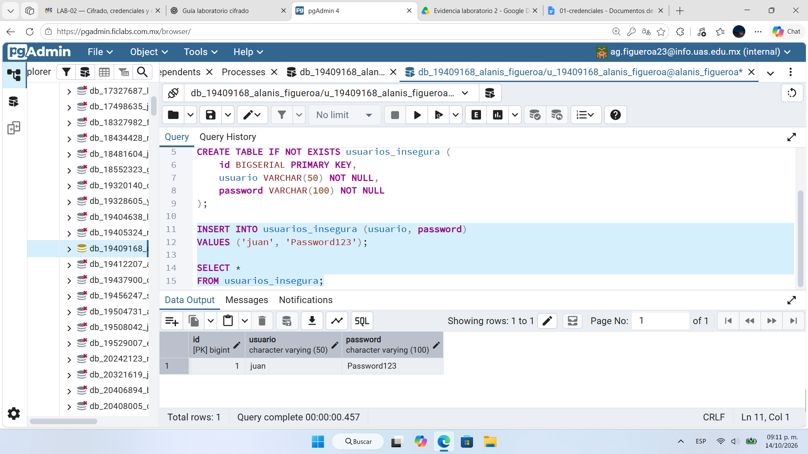
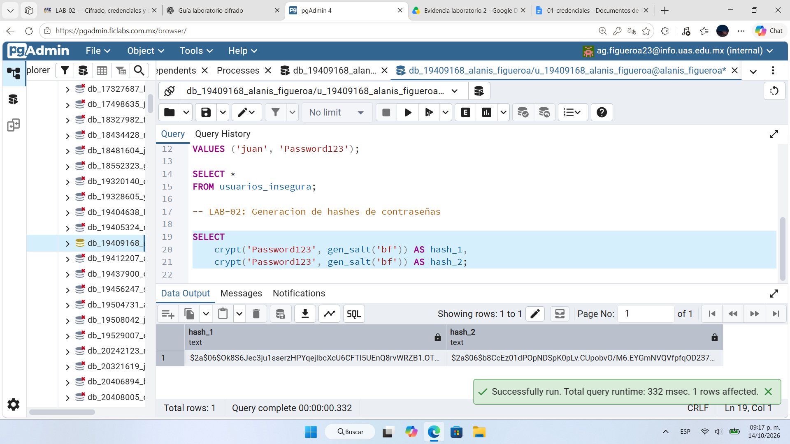
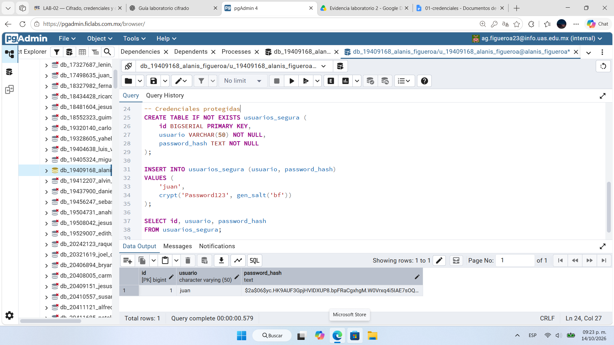
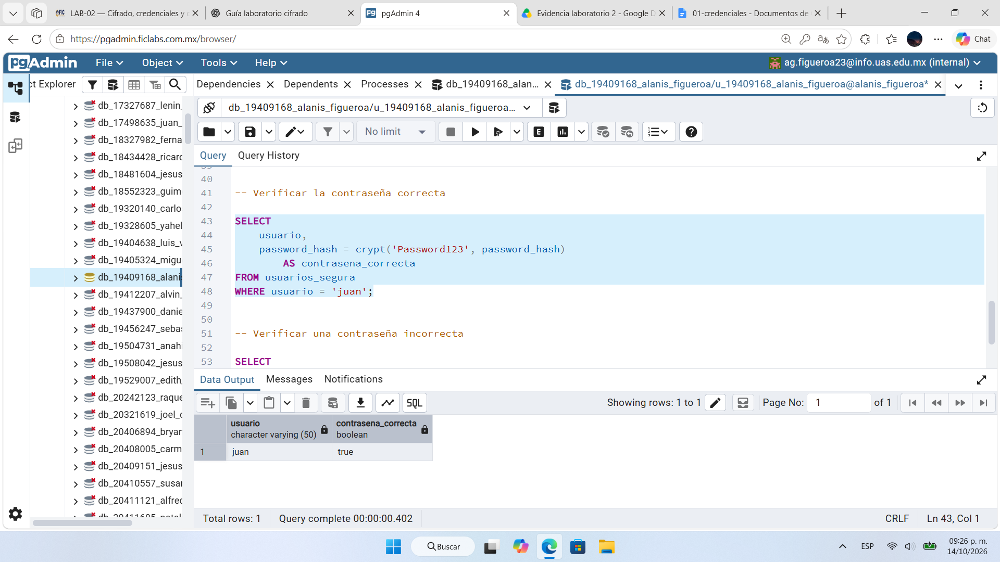
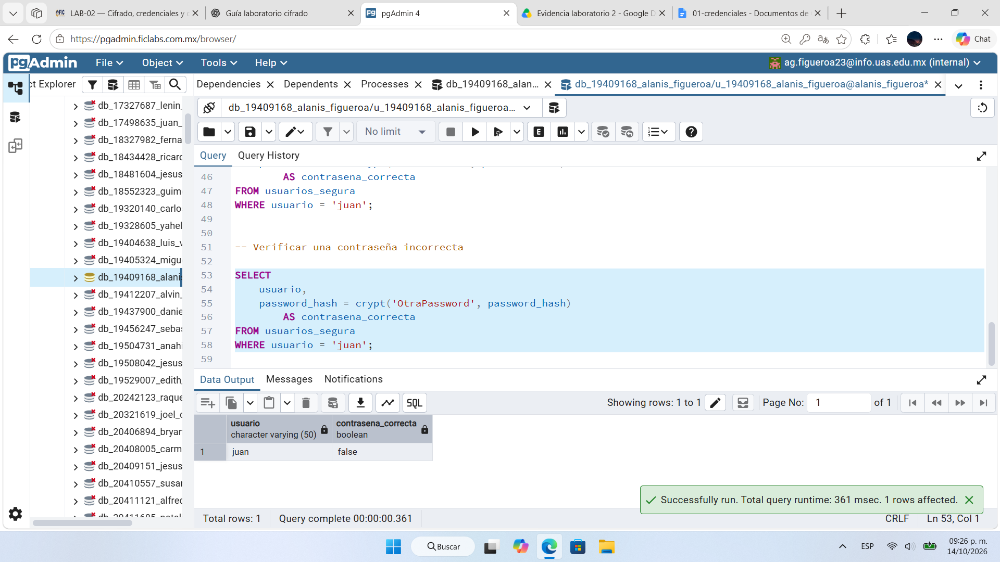

# Evidencia 01 — Protección de credenciales

## Objetivo
Demostrar el riesgo de guardar contraseñas en texto claro y comprobar que un hash con sal (bcrypt, `crypt()` + `gen_salt('bf')`) permite verificar credenciales sin almacenar la contraseña original.

## Comando o procedimiento
Script completo: [`../sql/01-credenciales.sql`](../sql/01-credenciales.sql). Ejecutado en pgAdmin con datos ficticios (usuario `juan`, contraseña de prueba `Password123`).

1. Crear `usuarios_insegura` (columna `password VARCHAR(100)`), insertar a `juan` y consultar la tabla.
2. Generar dos hashes de la misma contraseña:
   ```sql
   SELECT crypt('Password123', gen_salt('bf')) AS hash_1,
          crypt('Password123', gen_salt('bf')) AS hash_2;
   ```
3. Crear `usuarios_segura` (columna `password_hash TEXT`) e insertar con `crypt('Password123', gen_salt('bf'))`.
4. Verificar con `password_hash = crypt('<contraseña>', password_hash)`, con la contraseña correcta y con `OtraPassword`.

## Resultado obtenido
| Paso | Resultado |
|---|---|
| Consulta a `usuarios_insegura` | La columna `password` muestra `Password123` en claro. |
| `hash_1` | `$2a$06$Ok8S6Jec3ju1sserzHPYqejlbcXcU6CFTI5UEnQ8rvWRZB1.OT…` |
| `hash_2` | `$2a$06$b8CcEz01dPOpNDSpK0pLv.CUpobvO/M6.EYGmNVQVfpfqOD237…` |
| `usuarios_segura.password_hash` | `$2a$06$yc.HK9AUF3GpjHVIDXUP8.bpFRaCgxhgM.W0Vrxq4i5IAE7sOQ…` |
| Verificación con `Password123` | `true` |
| Verificación con `OtraPassword` | `false` |

Capturas:






## Análisis
- **Texto claro:** cualquiera con permiso de lectura sobre la tabla obtiene la contraseña tal cual, y puede probarla en otros servicios si el usuario la reutiliza.
- **Sal aleatoria:** los dos hashes difieren aunque la contraseña sea la misma porque `gen_salt('bf')` genera una sal nueva en cada llamada. Esto impide detectar contraseñas repetidas y vuelve poco útiles las tablas precalculadas.
- **`gen_salt()` y `crypt()`:** la primera genera la sal e indica el algoritmo (`bf` = bcrypt); la segunda calcula el hash.
- **No es cifrado reversible:** bcrypt es una función unidireccional. Para verificar, `crypt()` recibe el hash almacenado como segundo argumento, extrae de él la sal y el costo, recalcula y compara; por eso no hace falta guardar la contraseña original.
- **Costo:** el prefijo `$2a$06$` indica un factor de costo de 6 (valor por defecto de `gen_salt('bf')`). En un entorno real conviene un costo mayor, por ejemplo `gen_salt('bf', 12)`, o Argon2id desde la aplicación.

## Conclusión
Las contraseñas deben almacenarse como hashes con sal generados con una función diseñada para contraseñas, nunca en texto claro. El hash protege la contraseña si se filtra la tabla, pero no elimina otros riesgos: el propio hash debe protegerse con control de acceso y se deben usar contraseñas robustas y un costo adecuado.
