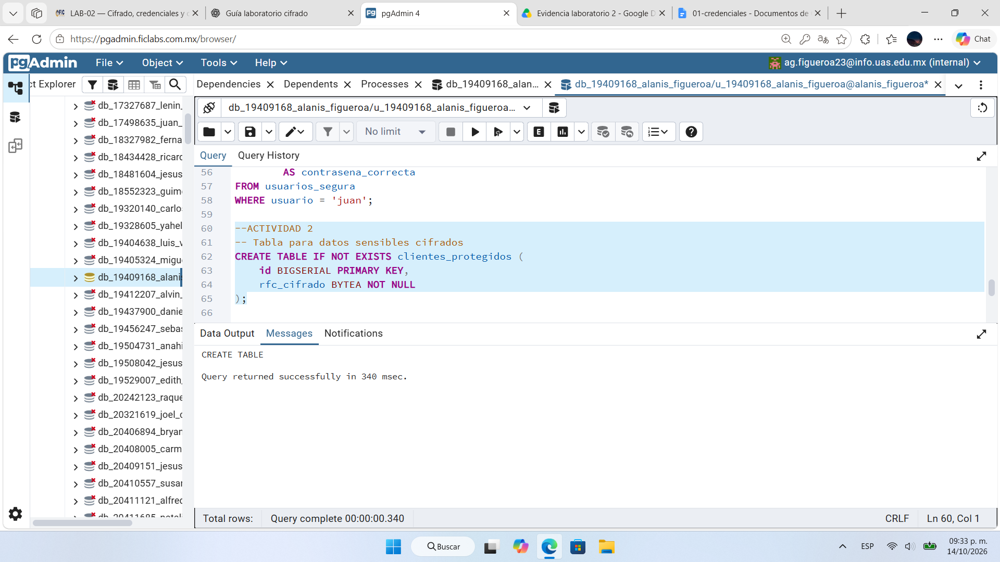
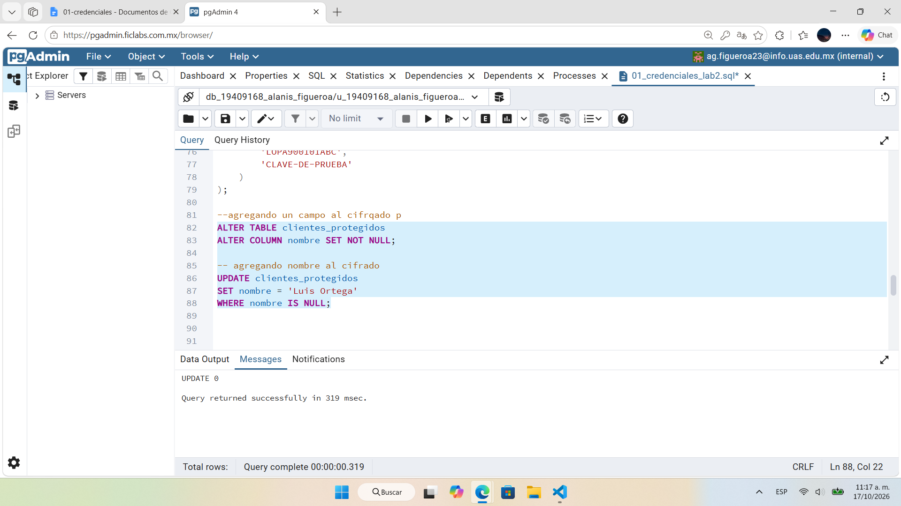
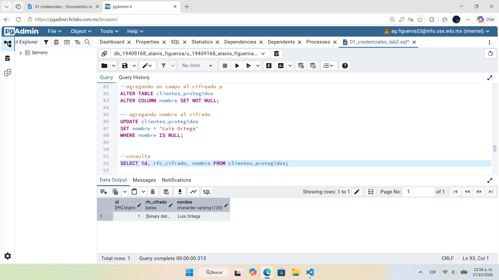
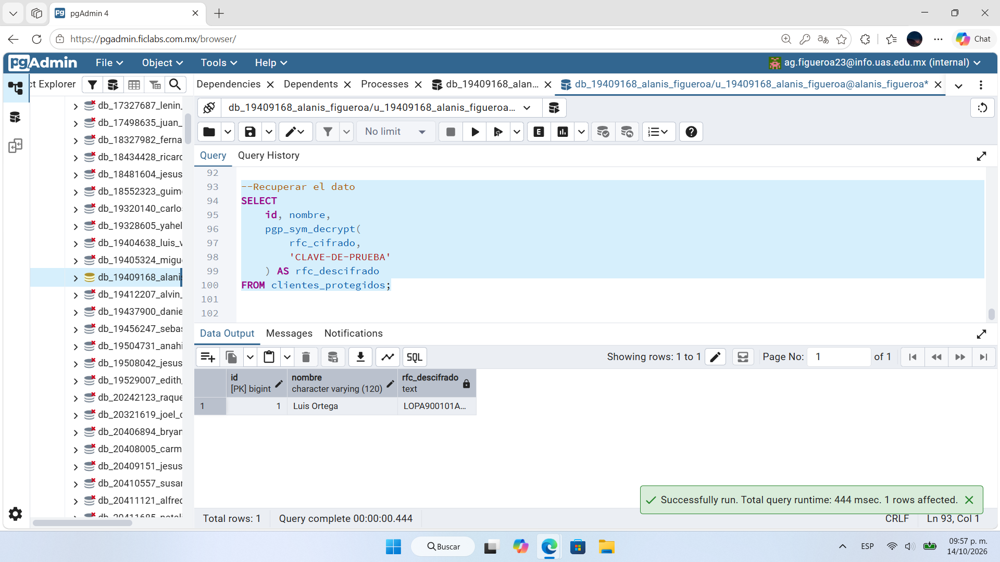

# Evidencia 02 — Cifrado de información sensible

## Objetivo
Proteger un dato personal (RFC ficticio) mediante cifrado simétrico con `pgp_sym_encrypt()` y comprobar que puede recuperarse con `pgp_sym_decrypt()` solo con la clave correcta.

## Comando o procedimiento
Script: [`../sql/02-cifrado-datos.sql`](../sql/02-cifrado-datos.sql). Datos ficticios; la clave usada en la práctica fue una clave de prueba.

1. Crear la tabla:
   ```sql
   CREATE TABLE IF NOT EXISTS clientes_protegidos (
       id BIGSERIAL PRIMARY KEY,
       rfc_cifrado BYTEA NOT NULL
   );
   ```
2. Insertar el RFC `LOPA900101ABC` con `pgp_sym_encrypt(...)`.
3. Agregar la columna `nombre` (`VARCHAR(120)`, `NOT NULL`) y asignar `Luis Ortega`.
4. Consultar `SELECT id, rfc_cifrado, nombre FROM clientes_protegidos;`
5. Recuperar el dato:
   ```sql
   SELECT id, nombre, pgp_sym_decrypt(rfc_cifrado, <clave>) AS rfc_descifrado
   FROM clientes_protegidos;
   ```

## Resultado obtenido
- La tabla se creó correctamente (`CREATE TABLE`, 340 ms).
- Al consultar, `rfc_cifrado` aparece como `[binary data]`; `nombre` se ve en claro (`Luis Ortega`).
- Con la clave correcta, `pgp_sym_decrypt()` devolvió `LOPA900101A…` (valor original, id 1).

Capturas:





## Análisis
- `crypt()` produce un hash (unidireccional, para verificar contraseñas); `pgp_sym_encrypt()` cifra con una clave y es reversible. Se usa hash cuando solo hay que comprobar un valor y cifrado cuando el dato original debe poder recuperarse (como el RFC).
- La columna es `BYTEA` porque el resultado cifrado es binario.
- Con una clave incorrecta `pgp_sym_decrypt()` falla con error y no devuelve el dato.
- El nombre quedó sin cifrar: el cifrado se aplicó solo al campo más sensible (RFC). El resto debe protegerse con control de acceso y enmascaramiento.
- Escribir la clave dentro de la consulta la deja expuesta en el historial de pgAdmin, en archivos `.sql` y en capturas (ver evidencia 03).

## Conclusión
El cifrado de columnas protege la confidencialidad del RFC en reposo: quien lea la tabla sin la clave solo ve datos binarios. Su seguridad depende por completo de la clave, que debe administrarse fuera del código y de los scripts.
