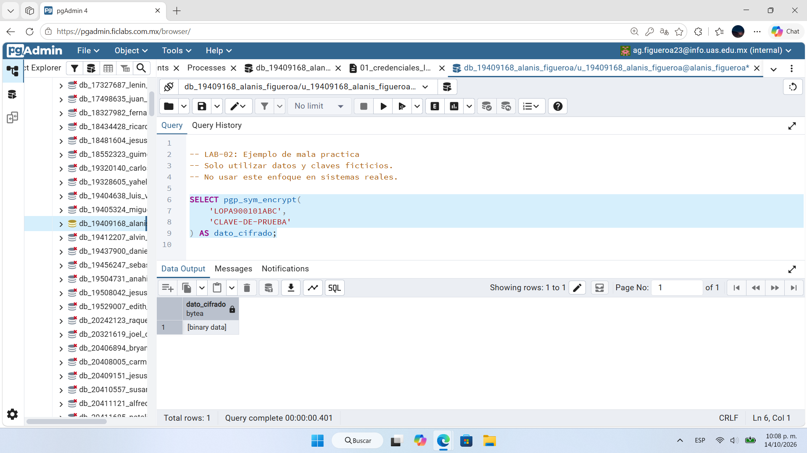
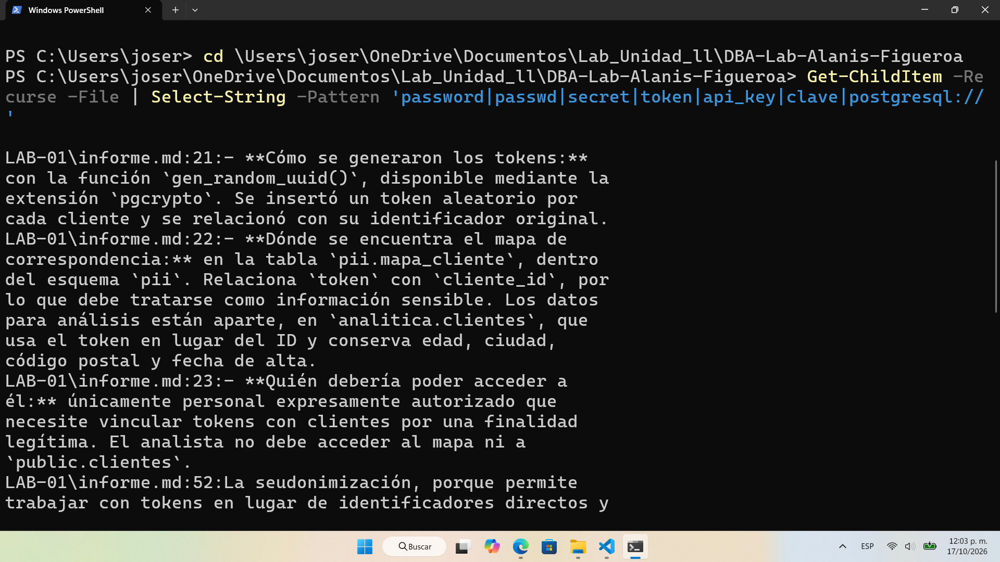

# Evidencia 03 — Gestión de claves

## Objetivo
Identificar la mala práctica de escribir claves directamente en una consulta SQL, evaluar su impacto y verificar que el repositorio no contenga secretos antes de publicarlo en GitLab.

## Comando o procedimiento
1. Se creó un archivo SQL de demostración con una clave ficticia escrita en la consulta:
   ```sql
   -- LAB-02: Ejemplo de mala practica. Solo datos y claves ficticios.
   SELECT pgp_sym_encrypt('LOPA900101ABC', '<clave-ficticia>') AS dato_cifrado;
   ```
2. Se revisó el repositorio local buscando posibles secretos (PowerShell):
   ```powershell
   Get-ChildItem -Recurse -File | Select-String -Pattern 'password|passwd|secret|token|api_key|clave|postgresql://'
   ```
3. Se eliminó el archivo de demostración antes de la entrega.

## Resultado obtenido
- La consulta de demostración se ejecutó y devolvió `[binary data]`; la clave quedó visible en el texto del script.
- La búsqueda de secretos encontró coincidencias en documentación y scripts del laboratorio anterior (`LAB-01\informe.md`, `03-seudonimizacion.sql`), relacionadas con los *tokens* de seudonimización y nombres de campos, no con credenciales reales.
- El archivo de demostración no se conserva en la entrega.

Capturas:



## Análisis
- Un script con la clave incluida permite descifrar los datos a cualquiera que lo lea; subido a un repositorio compartido, la clave queda además en el historial de Git aunque luego se borre el archivo.
- La búsqueda por palabras clave genera falsos positivos (como los *tokens* de seudonimización) y no garantiza detectar todos los secretos, por lo que los resultados se revisan manualmente. Falta revisar también las cadenas de conexión para confirmar que no incluyen credenciales.
- Medida preventiva: no escribir claves en código ni scripts; usar un gestor de secretos o KMS, variables de entorno o `\prompt`/`\set` en psql, y herramientas de escaneo de secretos antes de cada *push*.

## Conclusión
Las claves deben vivir separadas de los scripts y del repositorio. Un repositorio privado reduce la exposición pero no es un almacén de secretos. Antes de publicar se debe revisar el contenido y, si una clave llegara a subirse, tratarla como comprometida: revocarla y reemplazarla.
