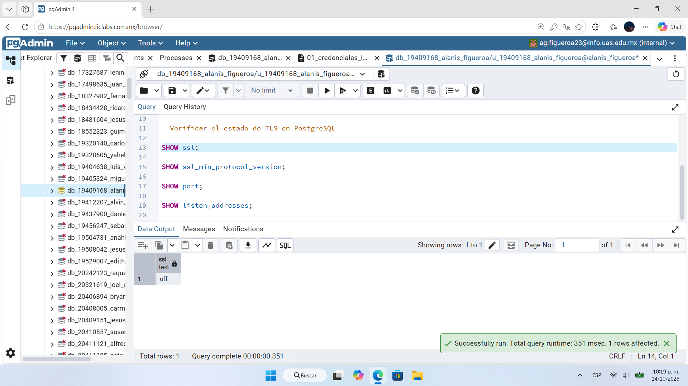
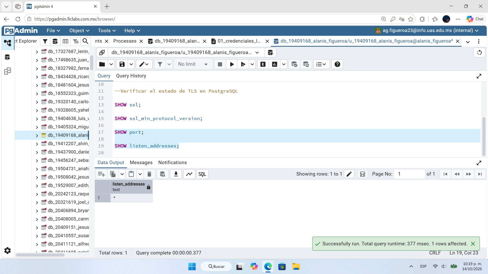
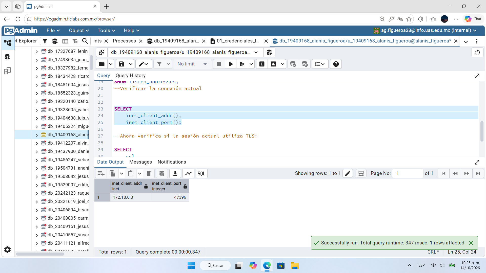
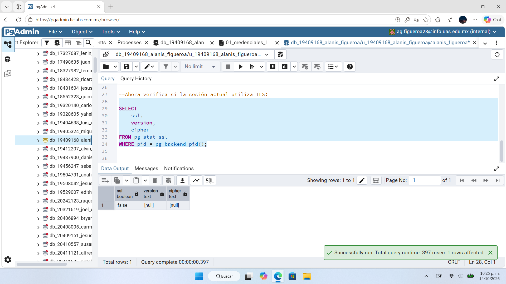
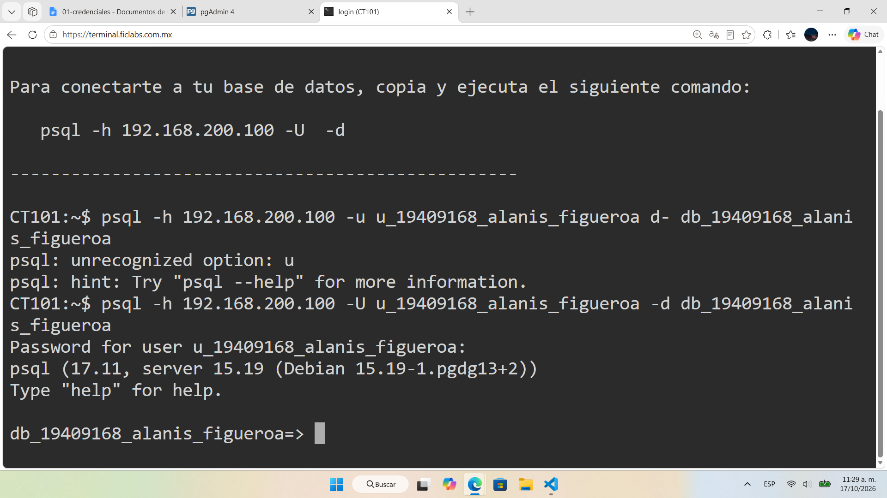
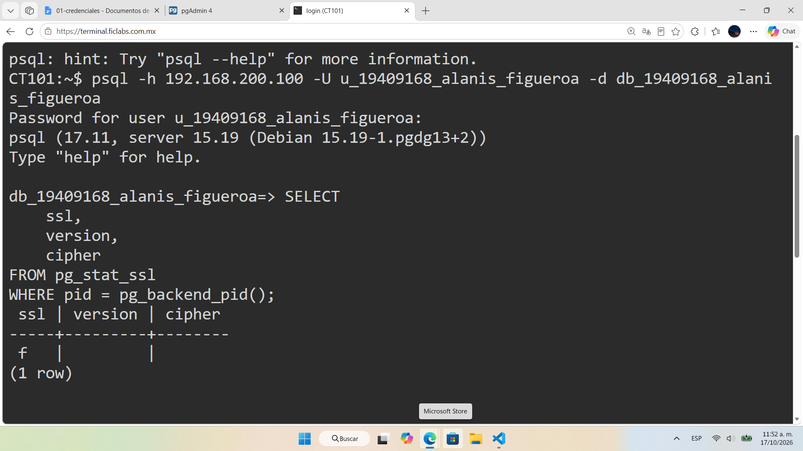
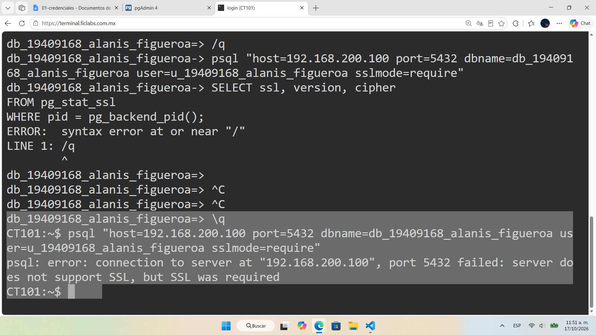

# Evidencia 04 — TLS en PostgreSQL

## Objetivo
Verificar si PostgreSQL y la sesión actual usan TLS para proteger los datos en tránsito, y probar una conexión que exija cifrado con `sslmode=require`.

## Comando o procedimiento
Script: [`../sql/03-verificacion-tls.sql`](../sql/03-verificacion-tls.sql).

1. Configuración del servidor (pgAdmin): `SHOW ssl;`, `SHOW ssl_min_protocol_version;`, `SHOW port;`, `SHOW listen_addresses;`
2. Conexión actual: `SELECT inet_client_addr(), inet_client_port();`
3. Estado de TLS de la sesión:
   ```sql
   SELECT ssl, version, cipher FROM pg_stat_ssl WHERE pid = pg_backend_pid();
   ```
4. Conexión desde la terminal con `psql`:
   ```bash
   psql -h 192.168.200.100 -U <usuario> -d <base>
   psql "host=192.168.200.100 port=5432 dbname=<base> user=<usuario> sslmode=require"
   ```

## Resultado obtenido
| Verificación | Resultado |
|---|---|
| `SHOW ssl;` | `off` |
| `SHOW listen_addresses;` | `*` |
| `inet_client_addr()` / `inet_client_port()` | `172.18.0.3` / `47396` |
| `pg_stat_ssl` (pgAdmin) | `ssl = false`, `version = NULL`, `cipher = NULL` |
| `pg_stat_ssl` (psql) | `ssl = f`, `version` y `cipher` vacíos |
| `psql ... sslmode=require` | `server does not support SSL, but SSL was required` |

La conexión por `psql` mostró cliente 17.11 y servidor 15.19. (Los valores de `ssl_min_protocol_version` y `port` no quedaron legibles en las capturas.)

Capturas:








## Análisis
- **Problema que resuelve TLS:** sin TLS, consultas y resultados viajan sin cifrar entre cliente y servidor y pueden ser leídos o alterados por quien observe la red. TLS aporta cifrado, integridad y, con la configuración adecuada, autenticación del servidor.
- **Estado del servidor:** `ssl = off`, por eso la sesión no usa TLS y no hay versión ni algoritmo (`cipher`). El servidor rechazó `sslmode=require`, lo que confirma que no admite SSL en esa dirección. Además, `listen_addresses = *` indica que acepta conexiones en todas las interfaces, lo que hace más importante el cifrado.
- **Modos de `sslmode`:** `disable` no usa TLS; `prefer` lo intenta si está disponible; `require` exige cifrado pero no valida la identidad del servidor; `verify-ca` valida el certificado contra una CA de confianza; `verify-full` además comprueba que el nombre del servidor coincida con el certificado (recomendado). No se pudo probar `verify-ca` ni `verify-full` porque el servidor no tiene SSL habilitado.
- Durante la práctica hubo errores de escritura al usar `psql` (`-u` en lugar de `-U`, `/q` en lugar de `\q`) que se corrigieron sin afectar los resultados.

## Conclusión
Se comprobó que la conexión del laboratorio **no** está protegida con TLS. Para una prueba positiva, el administrador debería habilitar `ssl = on` con certificado y clave del servidor y definir una versión mínima (TLS 1.2 o superior); los clientes deberían conectarse con `sslmode=verify-full`.
