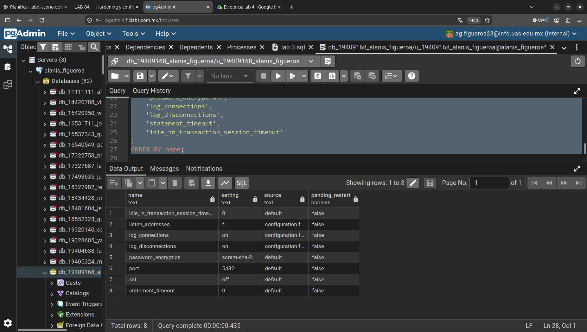
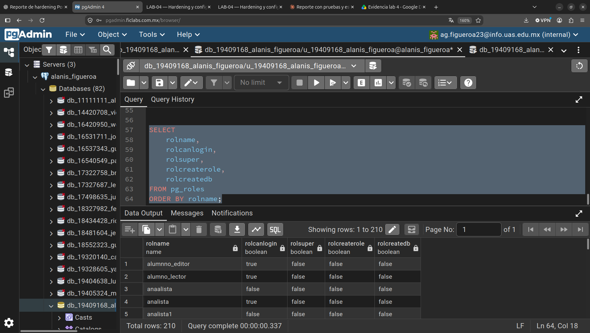
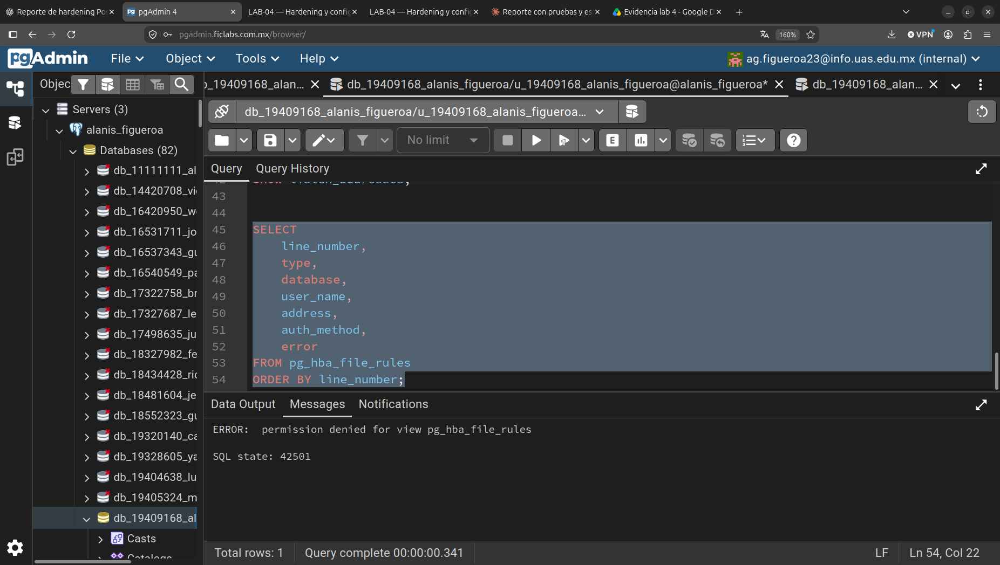
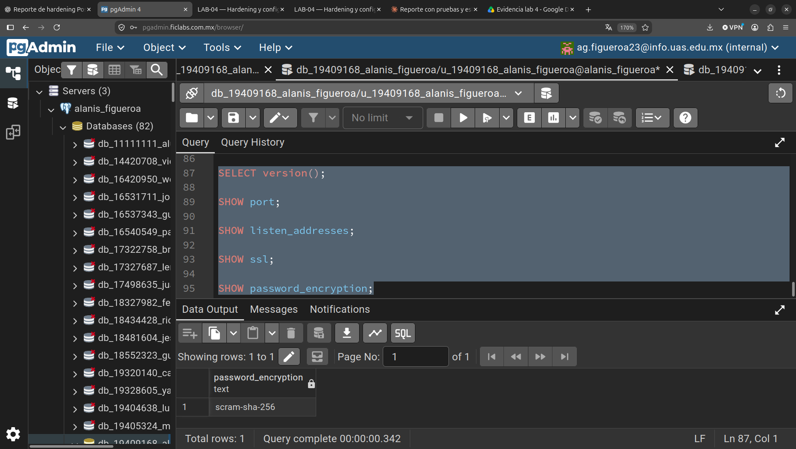
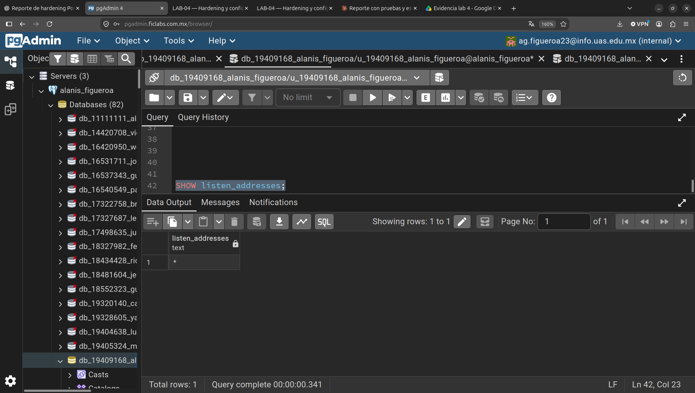
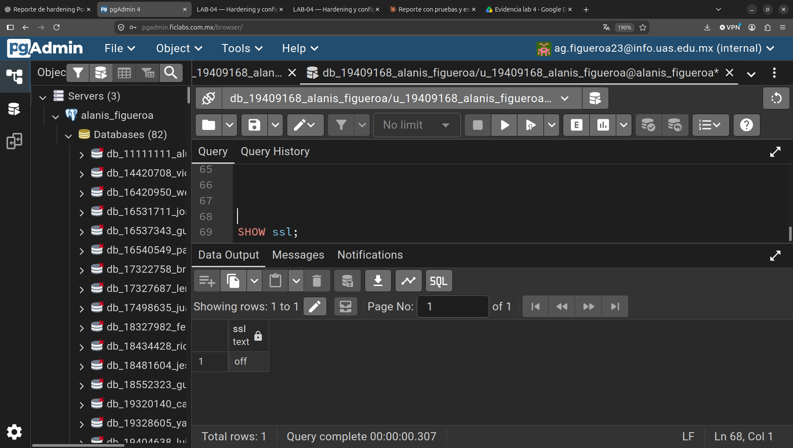

# LAB-04 — Hardening y configuración segura de PostgreSQL

**Alumno:** Alanís Guadalupe Figueroa Zazueta · **Materia/Unidad:** II — Seguridad, privacidad y control de acceso (Tema 2.6) · **Fecha:** 2026-10-25

## Objetivo

Aplicar un proceso básico de hardening a PostgreSQL 16: identificar configuraciones inseguras, reducir la
superficie de exposición y establecer controles de acceso, autenticación y configuración segura,
comparando el estado inicial con el posterior y justificando técnicamente cada cambio.

## Entorno

| Elemento | Valor |
|---|---|
| Motor | PostgreSQL 16.15 (Ubuntu 16.15-0ubuntu0.24.04.1) |
| SO | Ubuntu 24.04 (entorno aislado de laboratorio, sin acceso a producción) |
| Clúster | `16/main` · datos `/var/lib/postgresql/16/main` · config `/etc/postgresql/16/main` |
| BD de laboratorio | `comercial_norte` (tablas `clientes`, `pedidos`; datos ficticios) |
| Cuenta administrativa | `dba_lab` |
| Cuenta de prueba (SO) | `labuser` (sin relación con PostgreSQL, para probar permisos de archivos) |
| Cliente | `psql` 16 |

El estado inicial se **sembró** para reproducir el escenario de *Comercializadora Norte* (escucha en todas las
interfaces, reglas `0.0.0.0/0`, aplicación con `SUPERUSER`, extensiones innecesarias, archivos legibles por todos).
Detalle en [`configuracion/cambios.md`](configuracion/cambios.md).

## Superficie de ataque inicial



| Elemento | Estado actual (antes) | ¿Es necesario? | Riesgo |
|---|---|---|---|
| Puerto PostgreSQL | `5432/TCP` en `0.0.0.0:5432` | Sí el servicio; no en todas las interfaces | Alto: alcanzable desde cualquier red con ruta |
| Interfaces de escucha | `listen_addresses = '*'` | No: solo se requiere `localhost`/red de aplicación | Alto: amplía la exposición |
| Conexiones remotas | Aceptadas desde la IP no local `192.0.2.2` (probado) | Solo desde Red DBA / host de la aplicación | Alto |
| Usuarios administrativos | `dba_lab`, `postgres` y **`app_web` (SUPERUSER usado por la app)** | `app_web` no | Crítico: compromiso de la app = compromiso del servidor |
| SSL/TLS | `ssl=on`, pero **no obligatorio** (conexión sin TLS aceptada) | Sí, obligatorio | Medio-Alto: tráfico en claro posible |
| Métodos de autenticación | `scram-sha-256` (correcto) pero con `host all all 0.0.0.0/0` y `::/0` | Método sí; alcance no | Alto |

## Hallazgos

Resumen de los hallazgos iniciales (la verificación automática inicial arrojó **6 OK / 11 FALLA**, ver [evidencia 06](evidencias/06-verificacion.png)):

1. **Exposición de red:** `listen_addresses='*'` y socket en `0.0.0.0:5432` (Act. 3 y 13).
2. **`pg_hba.conf` permisivo:** líneas 135 y 136 `host all all 0.0.0.0/0` y `::/0` con `scram-sha-256`: cualquier BD, cualquier usuario, cualquier origen (Act. 4 y 5).
3. **Cuenta de aplicación con `SUPERUSER`** (`app_web`), propietaria de la BD y de las tablas (Act. 8 y 9).
4. **Cuenta heredada** `reporte_old` (`CREATEDB`, sin responsable) (Act. 8).
5. **Extensiones innecesarias:** `dblink` y `file_fdw` (Act. 10).
6. **Sin trazabilidad:** `log_connections=off`, `log_disconnections=off` (Act. 2).
7. **Conexiones sin límite de inactividad:** `idle_in_transaction_session_timeout=0`, `idle_session_timeout=0`, `max_connections=100` (Act. 11).
8. **Archivos de configuración legibles por cualquier usuario del SO** (`0644`; directorio `0755`): `labuser` pudo leer `pg_hba.conf` (Act. 12).
9. **TLS no obligatorio:** una conexión con `sslmode=disable` fue aceptada (Act. 15).
10. **Sin documentación/baseline/checklist/política de actualización** (Act. 16–19; resuelto en este laboratorio).

**Aspectos correctos encontrados:** `password_encryption=scram-sha-256` y todos los hashes ya eran SCRAM (ninguno `md5`); `ssl=on` con `TLSv1.2` mínimo; directorio de datos `0700`; ninguna regla `trust`.

### Archivos y rutas (Act. 2)

| Categoría | Ruta |
|---|---|
| Configuración | `/etc/postgresql/16/main/postgresql.conf` |
| Autenticación | `/etc/postgresql/16/main/pg_hba.conf` |
| Mapeo de identidades | `/etc/postgresql/16/main/pg_ident.conf` |
| Datos | `/var/lib/postgresql/16/main` |
| Logs | `log_directory = 'log'` (en Debian/Ubuntu el log efectivo está en `/var/log/postgresql/postgresql-16-main.log`) |

### Roles (Act. 8) y cuentas (Act. 9)



**Antes**

| Rol | LOGIN | SUPERUSER | CREATEROLE | CREATEDB | Función |
|---|---|---|---|---|---|
| `postgres` | Sí | Sí | Sí | Sí | Cuenta interna del servidor (administración local) |
| `dba_lab` | Sí | Sí | Sí | Sí | DBA |
| `app_web` | Sí | **Sí** | No | No | Aplicación (**incorrecto**) |
| `reporte_old` | Sí | No | No | **Sí** | Cuenta heredada, sin uso justificado |

**Después**

| Cuenta | Propósito | LOGIN | Privilegios |
|---|---|---|---|
| `dba_lab` (DBA) | Administración | Sí | Administrativos; solo desde Red DBA con TLS |
| `app_comercial` (APP) | Aplicación | Sí | `SELECT/INSERT/UPDATE` en `clientes`, `pedidos`; sin DDL ni `DELETE`; límite 20 conexiones |
| `consulta_norte` (CONSULTA) | Consulta | Sí | Solo `SELECT`; límite 5 conexiones |

## Cambios realizados

Resumen (detalle completo con antes/después y reversión en [`configuracion/cambios.md`](configuracion/cambios.md)):

| Área | Cambio |
|---|---|
| Red | `listen_addresses='*'` → `'localhost'` |
| `pg_hba.conf` | Se sustituyeron `0.0.0.0/0` y `::/0` por reglas `hostssl` específicas (BD + usuario + origen + método) y `reject` explícitos |
| Roles | Creadas `app_comercial` y `consulta_norte`; eliminadas `app_web` y `reporte_old`; propiedad de objetos a `dba_lab`; `REVOKE` a `PUBLIC` |
| Extensiones | Eliminadas `dblink` y `file_fdw` |
| Parámetros | `max_connections=50`, timeouts de inactividad, `statement_timeout` por rol, logging de conexiones y DDL |
| SO | `/etc/postgresql/16/main` → `0750`; `*.conf` → `0640` |

`pg_hba.conf` resultante:



## Justificación de los cambios

| Cambio | Justificación técnica |
|---|---|
| `listen_addresses='localhost'` | Principio *secure by default* / mínima exposición: si el servicio no escucha en una interfaz, no existe superficie en ella. Se verificó con `ss` y con una conexión rechazada a la IP no local. |
| Reglas `hostssl` específicas | Mínimo privilegio aplicado a la red: BD + usuario + origen + método. `0.0.0.0/0` es una decisión de exposición que requiere justificación; no la había. |
| TLS obligatorio (`hostssl`) | `ssl=on` solo *permite* cifrar; `hostssl` lo *exige*. Evita credenciales y datos en claro. |
| Separar DBA / APP / CONSULTA | Una aplicación comprometida (p. ej. por SQL injection) no debe heredar capacidades de superusuario (leer archivos, crear roles, ejecutar programas, alterar estructura). |
| Eliminar `reporte_old`, `dblink`, `file_fdw` | Reducir funcionalidad y cuentas no necesarias para el propósito del sistema. |
| Timeouts y `max_connections` | Disponibilidad: sesiones inactivas o consultas sin fin consumen conexiones/memoria y retienen *locks*. |
| `log_connections/disconnections`, `log_statement='ddl'` | Sin trazabilidad no hay detección ni investigación; los logs ya muestran método de autenticación, TLS y regla de `pg_hba` aplicada. |
| Permisos `0750/0640` | La seguridad de `GRANT/REVOKE` no protege archivos: un usuario del SO que lea `pg_hba.conf`/`postgresql.conf` obtiene información de reconocimiento. |

## Verificación

**Verificación automática** (`sql/04-verificacion.sql`): de **6 OK / 11 FALLA** a **17 OK / 0 FALLA**.



**Pruebas funcionales** (ver imágenes `02`, `04` y `05`):

| Prueba | Antes | Después |
|---|---|---|
| Socket de escucha (`ss -lntp`) | `0.0.0.0:5432` | `127.0.0.1:5432` |
| Conexión a la IP no local `192.0.2.2` | **Aceptada** | `Connection refused` |
| Conexión sin TLS (`sslmode=disable`) | **Aceptada** | `pg_hba.conf rejects connection ... no encryption` |
| Conexión con TLS (`sslmode=require`) | Aceptada | Aceptada (TLSv1.3, `TLS_AES_256_GCM_SHA384`) |
| `app_comercial` → BD `postgres` | — | `pg_hba.conf rejects connection` |
| `app_comercial` → `comercial_norte` (SELECT) | — | Permitido |
| `app_comercial` → `DELETE FROM pedidos` | — | `permission denied for table pedidos` |
| `app_comercial` → `CREATE ROLE ... SUPERUSER` | — | `permission denied to create role` |
| Usuario SO `labuser` lee `pg_hba.conf` | **Lectura permitida** | `Permission denied` |




### Línea base antes/después (Act. 16)

| Control | Antes | Después | Justificación |
|---|---|---|---|
| `listen_addresses` | `*` | `localhost` | Reducir exposición de red |
| `pg_hba.conf` | `all/all` desde `0.0.0.0/0` y `::/0` | Allowlist `hostssl` por BD/usuario/origen + `reject` | Mínimo privilegio de acceso |
| Método de autenticación | `scram-sha-256` (alcance excesivo) | `scram-sha-256` + `peer` solo para `postgres` | Método correcto; alcance acotado |
| Usuarios administrativos | `postgres`, `dba_lab`, `app_web` (app) | `postgres`, `dba_lab` | Admin separado de aplicación |
| Cuentas de aplicación | `app_web` SUPERUSER | `app_comercial` sin privilegios administrativos | Mínimo privilegio |
| Puerto | 5432 | 5432 (sin cambio) | Cambiar puerto no es control de seguridad |
| TLS | `ssl=on`, no obligatorio | `hostssl` obligatorio, mín. TLS 1.2 (se negoció 1.3) | Cifrado en tránsito exigido |
| Permisos SO | conf `0644`, dir `0755` | conf `0640`, dir `0750`, datos `0700` | Proteger archivos sensibles |
| Extensiones | `dblink`, `file_fdw`, `pgcrypto`, `plpgsql` | `pgcrypto`, `plpgsql` | Solo funcionalidad necesaria |
| Conexiones | `max=100`, sin timeouts, sin logs | `max=50`, timeouts, logs de conexión | Disponibilidad y trazabilidad |

## Checklist de hardening

| # | Control | Verificado | Evidencia |
|---|---|---|---|
| 1 | Puerto documentado (5432/TCP) | ✅ | `01-superficie-ataque.png` |
| 2 | Interfaces de escucha justificadas (`localhost`) | ✅ | `02-listen-addresses.png` |
| 3 | `pg_hba.conf` revisado | ✅ | `03-pg-hba.png` |
| 4 | Redes autorizadas restringidas (sin `0.0.0.0/0`/`::/0`) | ✅ | `03-pg-hba.png`, verificación #5 |
| 5 | Autenticación segura (`scram-sha-256`, sin `trust`/`md5`) | ✅ | verificación #4, #6, #17 |
| 6 | Superusuarios identificados (solo `postgres`, `dba_lab`) | ✅ | `04-roles.png`, verificación #9 |
| 7 | Cuentas de aplicación separadas de las administrativas | ✅ | `04-roles.png`, verificación #8 |
| 8 | Privilegios mínimos (`app_comercial`, `consulta_norte`) | ✅ | `04-roles.png` (pruebas `DELETE`/`CREATE ROLE`) |
| 9 | Extensiones revisadas y reducidas | ✅ | `04-roles.png`, verificación #11 |
| 10 | TLS verificado y obligatorio | ✅ | `05-tls.png` |
| 11 | Configuración protegida (`0640`/`0750`) | ✅ | `02-listen-addresses.png` |
| 12 | Directorio de datos protegido (`0700`) | ✅ | `02-listen-addresses.png` |
| 13 | Firewall documentado | 📄 Documentado (no aplicado) | `configuracion/baseline.md` (Anexo A) |
| 14 | Actualizaciones documentadas (política) | 📄 Documentado | `configuracion/baseline.md` §7 |
| 15 | Configuración registrada (cambios + respaldo) | ✅ | `configuracion/cambios.md` |
| 16 | `PUBLIC` sin `CONNECT` ni `CREATE`/`USAGE` heredados | ✅ | verificación #12 |
| 17 | Logging de conexiones/desconexiones activo | ✅ | verificación #13–14 |
| 18 | Timeouts de sesión/transacción/consulta configurados | ✅ | verificación #15; `ALTER ROLE ... SET statement_timeout` |
| 19 | Límite de conexiones global y por rol | ✅ | verificación #16; `rolconnlimit` |
| 20 | Cuentas heredadas eliminadas | ✅ | verificación #10 |

## Conclusiones

1. La mayor reducción de exposición vino de **tres cambios combinados**: dejar de escuchar en `*`, reemplazar las reglas `0.0.0.0/0`/`::/0` por una allowlist y exigir TLS. Cada uno cierra una capa distinta (red, autenticación, transporte).
2. La contraseña (**autenticación**) ya era robusta (SCRAM), pero eso **no** era suficiente: el riesgo principal era la **autorización** (aplicación con `SUPERUSER`) y la **exposición** (cualquier origen, cualquier BD).
3. Cambiar el puerto, o confiar en contraseñas fuertes, no sustituye el hardening por capas (SO → red → PostgreSQL → autenticación → autorización → datos → aplicación).
4. Cada cambio se **verificó** con pruebas positivas y negativas, y se documentó con antes/después, respaldo y procedimiento de reversión.
5. **Limitaciones:** el firewall (Act. 14) y la política de actualización quedaron como diseño documentado, no aplicado; el certificado TLS es el de laboratorio (*snakeoil*); en producción se requiere certificado de una CA, `sslmode=verify-full` y un gestor de secretos.

## Contenido del repositorio

```
lab-04-hardening/
├── README.md
├── sql/
│   ├── 01-inspeccion.sql
│   ├── 02-roles.sql
│   ├── 03-configuracion.sql
│   └── 04-verificacion.sql
├── configuracion/
│   ├── baseline.md
│   └── cambios.md
├── evidencias/
│   ├── 01-superficie-ataque.png
│   ├── 02-listen-addresses.png
│   ├── 03-pg-hba.png
│   ├── 04-roles.png
│   ├── 05-tls.png
│   └── 06-verificacion.png
└── informe.md
```
